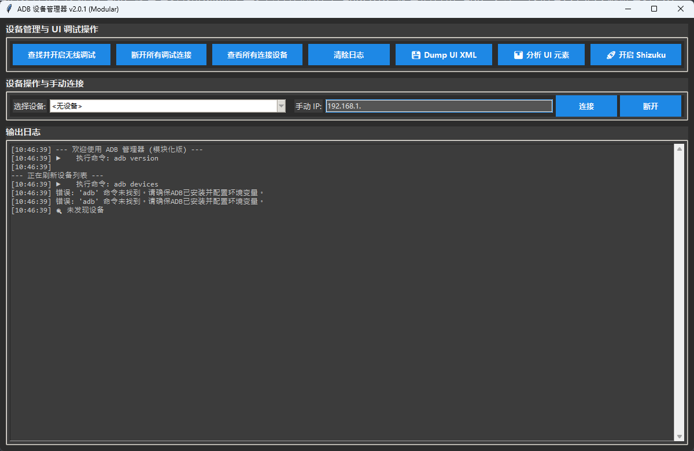

# ADB 管理器 (ADB Manager) v2.0.1 (Modular)

这是一个基于 Python 和 Tkinter 构建的现代化、模块化 ADB 设备管理图形界面工具。它旨在简化与 Android 设备的日常 ADB 交互，包括有线/无线调试管理、UI 视图分析以及高级工具（如 Shizuku）的快速启动。

## 主要功能

*   **设备连接管理：**
    *   **无线调试配对：** 一键查找通过 USB 连接的设备，并自动尝试开启 `5555` 端口进行无线 (WIFI) 调试连接。
    *   **手动 IP 连接/断开：** 支持通过输入设备的 IP 地址进行手动连接或断开。
    *   **一键断开所有连接：** 快速清理所有当前的 ADB 连接。
    *   **设备列表自动刷新与展示。**
*   **UI 自动化与分析 (基于 uiautomator2)：**
    *   **Dump UI XML：** 一键获取当前设备屏幕的 UI 层次结构，并保存为本地 XML 文件，方便离线查看和分析。
    *   **分析 UI 元素：** 在软件的输出日志中以树状结构直接打印当前屏幕的 UI 元素信息（类名、文本、描述、ID、坐标），便于快速定位元素。
*   **快捷指令：**
    *   **开启 Shizuku：** 快捷执行 Shizuku 启动脚本 (针对 `/storage/emulated/0/Android/data/moe.shizuku.privileged.api/start.sh`)。
*   **现代化界面：** 采用深色主题，支持异步操作与实时日志输出。

## 项目结构

项目采用模块化设计，代码结构清晰：

*   `main.py` - 主程序入口，负责构建 Tkinter GUI 界面、事件绑定、多线程任务调度及实时日志显示。
*   `adb_utils.py` - ADB 核心工具模块，封装了底层的 `adb` 命令调用、设备获取、连接控制以及无线调试配置的逻辑。
*   `ui_actions.py` - 业务功能模块，集成 `uiautomator2` 进行 UI XML 抓取、元素树分析，以及 Shizuku 的启动命令下发。
*   `config.py` - 配置文件，存放程序的常量定义（如深色主题的颜色配置等）。

## 依赖环境

*   Python 3.x
*   [ADB 环境](https://developer.android.com/studio/command-line/adb) (需配置到系统环境变量 `PATH` 中)
*   Python 库依赖:
    ```bash
    pip install uiautomator2
    ```

## 运行方式

直接运行主脚本即可启动图形界面：

```bash
python main.py
```

## 注意事项

*   使用“开启无线调试”功能前，请先确保手机已通过 USB 数据线连接到电脑，并已允许 USB 调试。
*   UI 分析与 Dump 功能依赖于 `uiautomator2`。首次使用相关功能时，`uiautomator2` 会自动在手机端安装必要的服务 APK（如 `ATX`），请在手机上允许安装。
*   “开启 Shizuku”功能需要手机端已安装 Shizuku APP。

## 界面预览



本程序包含顶部操作按钮区、中部设备选择及手动连接区，以及底部带有实时反馈的日志显示区，所有耗时操作均在后台线程进行，保证界面不卡顿。
